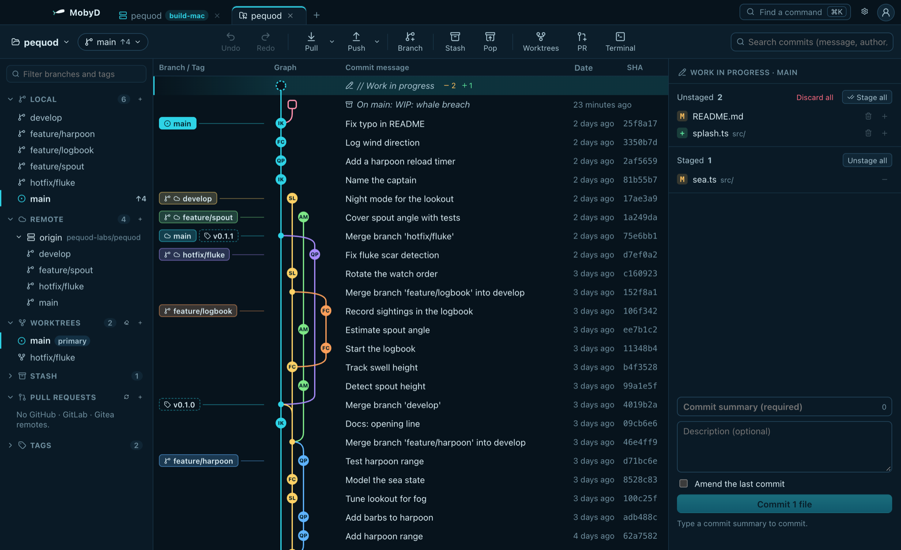

<p align="center">
  
</p>

<h1 align="center">MobyD</h1>

<p align="center">
  A fast, native Git client for macOS — with repositories on your other machines, over SSH.
</p>

<p align="center">
  <a href="https://github.com/gyeongjin-kim/MobyD-releases/releases/latest"></a>
  
</p>

<p align="center">
  <a href="https://github.com/gyeongjin-kim/MobyD-releases/releases/latest/download/MobyD-macOS-arm64.dmg"><b>⬇ Download MobyD for macOS (.dmg)</b></a>
</p>

<p align="center">
  
</p>

This repository holds the release builds of MobyD and the update feed the app reads. Every release carries:

| File | |
|---|---|
| `MobyD-macOS-arm64.dmg` | The installer. The link above always serves the newest one. |
| `MobyD.app.tar.gz` | The signed archive a running MobyD downloads to update itself. |
| `latest.json` | The update feed: newest version, its signature and where to get it. |

## Install

1. Download **[MobyD-macOS-arm64.dmg](https://github.com/gyeongjin-kim/MobyD-releases/releases/latest/download/MobyD-macOS-arm64.dmg)** and drag MobyD into Applications.
2. MobyD is not notarized yet, so the first launch is blocked by Gatekeeper. Right-click MobyD → **Open**, or run:

   ```bash
   xattr -dr com.apple.quarantine /Applications/MobyD.app
   ```

Requires macOS on Apple silicon and Git 2.36+.

## Updates

MobyD checks this feed at launch and every few hours. When a newer version exists, an **Update** button appears in the top bar; one click downloads it, verifies its signature, installs it and restarts the app. You can also check by hand under Preferences → General.
